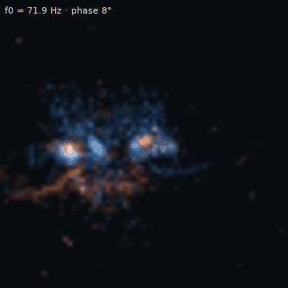
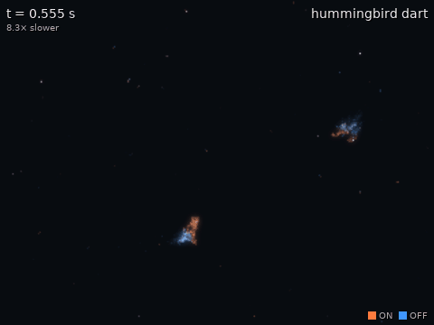
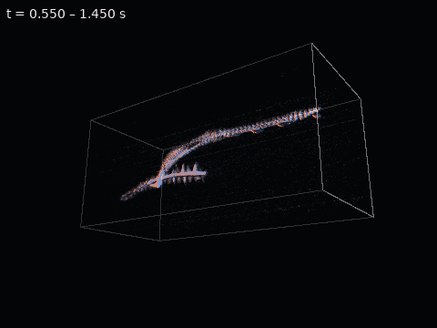
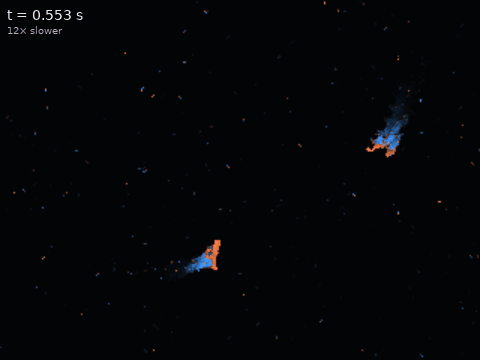
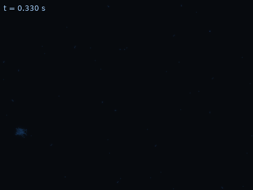
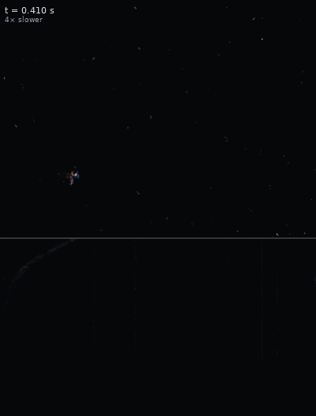
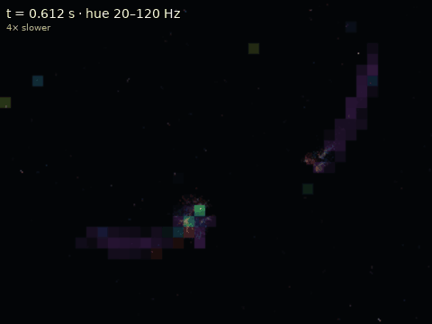
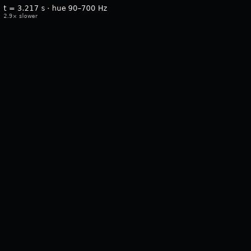
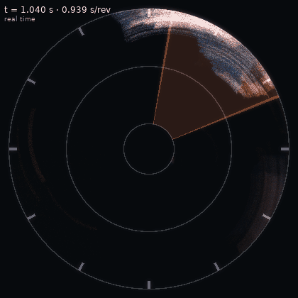

# GottLUX Studio — visualization methods, animations and export

**Bottom line.** The Studio turns a span of an event-camera recording into a short GIF, MP4 or
WebM in a few seconds. You pick one of nine *looks* (visualization methods), frame the shot
(span, crop, speed), style it, and export. The same shot recipe runs in three places:

| Where | How |
|---|---|
| Desktop | the **Studio** tab in `gottlux-gui` (live looping preview, drag-to-crop, export on a worker thread) |
| Command line | `gottlux-studio REC --look strobe --t0 1.0 --t1 1.45 --crop 0,110,68,178 -o wings.gif` |
| Browser | `web/studio.html` on the GottLUX site: sample clips, quick recipes, a built-in GIF encoder, MP4/WebM capture, share links |
| Python | `from gottlux.studio import Shot, export_shot` |

Every export writes `<file>.shot.json` beside it: the complete recipe, so a clip can be
re-made or tweaked. The desktop *Load recipe…*, `gottlux-studio --recipe` and the web Studio
all read the same JSON.





---

## 1. Quick start

**Desktop.** Load a recording, open the **Studio** tab. The span defaults to the transport's
In/Out selection, or the first second. Pick a look, adjust its parameters (the panel is built
from the look's parameter list), click **Crop** and drag a box around the subject, then
**Export**. Presets set format, width and frame rate in one step: `gif` (480 px, 25 fps),
`gif-small`, `gif-large`, `mp4` (720 px, 30 fps), `mp4-hd`, `mp4-smooth` (60 fps) and `webm`.
Files go to `~/Videos/GottLux Studio` unless you choose a folder. They never overwrite: a
second export of the same shot gets `_2`.

**Command line.**

```bash
gottlux-studio --list                                    # looks and every parameter
gottlux-studio clip.raw --look trails --t0 0.55 --t1 1.1 --crop 0,40,320,280 \
               --speed 0.12 --bloom 0.7 --legend -o dart.gif
gottlux-studio clip.raw --look spacetime --t0 0.55 --t1 1.45 --set freeze=true \
               --set orbit_deg=360 --set depth_ms=900 --preset mp4 -o orbit.mp4
gottlux-studio clip.raw --recipe dart.gif.shot.json --preset mp4-hd -o dart.mp4
gottlux-studio clip.raw --reel reel/ --t0 0.6 --t1 1.4   # every look, one clip each
```

**Browser.** Open `studio.html`, pick a sample clip or drop a local `.raw`. Decoding and
rendering stay in the tab; nothing is uploaded. Drag on the event-rate strip to choose the
span. **Copy link** puts the whole shot in the URL (`#shot=…`); the link reopens that exact
shot on a hosted sample clip. **Recipe** downloads the `.shot.json`.

**Python.**

```python
import gottlux
from gottlux.studio import Shot, ShotRenderer, export_shot
rec = gottlux.load("examples/data/Humming_Bird_Fight_merged_2.raw")
shot = Shot(look="strobe", t0=1.0, t1=1.45, crop=(0, 110, 68, 178), bloom=0.8)
facts = export_shot(rec, shot, "wings.gif")          # {'path', 'frames', 'size', 'f0_hz', ...}
frame = ShotRenderer(rec, shot).frame(0)             # one uint8 (H, W, 3) frame
```

---

## 2. From events to a frame

### 2.1 What the sensor reports

Each pixel of an event camera tracks its own log intensity, `L = log I`. When `L` has
changed by more than a contrast threshold `C` since the pixel's last event, the pixel emits
an event

```
e_i = (x_i, y_i, p_i, t_i)        p_i = ON if L rose by C, OFF if it fell by C
```

with microsecond timing, and resets its reference. A static scene produces nothing but
noise. An edge moving across a pixel produces a burst of events whose polarity says
whether the pixel got brighter or darker. A wing beating at `f0` makes the pixels it crosses
fire periodically. There are no frames: every picture below is a choice about how to turn
the events up to a time `τ` into pixels.

### 2.2 Shot timing

`speed` is recording seconds shown per second of output (0.1 = ten times slower than life).
A shot over `[t0, t1]` at `fps` frames per second has

```
n_frames = max(1, floor((t1 − t0) · fps / speed + ½))
τ_k      = t0 + (k + 1) · (t1 − t0) / n_frames          (frame k shows the events up to τ_k)
```

Each look reads its own look-back before `τ_k` (5 T for a trail, the window for a heat
frame, the depth of the space-time box…). The renderer slices `[t0 − look-back, t1]` once.
Frames are independent, so the preview can jump to any frame. The stroboscope is the one
look that sets its own frame count (phase bins × loops).

### 2.3 Denoise (on by default)

Two filters from `gottlux.core.denoise`, applied to the shot's events:

- **Hot-pixel cut.** Pixels whose event count is at or above the 99.9th percentile of the
  non-zero counts are dropped. On the 3 s hummingbird clip the hottest pixel fires 19,262
  times, and the cut falls at 3,739 events.
- **Background-activity filter (BAF).** An event is kept only if one of its 8 neighbours
  fired within the last `baf_us` (default 2 ms). Shot noise is spatially isolated and
  disappears; edges are not. On the 3 s hummingbird clip, 203,346 of 1,434,823 events
  survive.

### 2.4 Layers, exposure and compositing

A look returns **layers**: an opacity map `α(x, y) ∈ [0, 1]` with a colour (one colour, or one
per pixel). The renderer composites them over the palette background:

- **dark background:** additive, `out = bg + Σ α·colour`. ON and OFF overlapping add
  towards white, like light.
- **light background:** "over", `out = out·(1 − α) + α·colour`.

**Exposure is locked per shot.** Each look measures its brightness scale once, on about 10–12
frames spread over the shot (the 98–99.5th percentile of the non-zero values), and uses that
scale for every frame. Per-frame normalisation would make the clip pump in brightness as
activity rises and falls.

After compositing come display gamma (`out^(1/γ)`), resampling to the output width (bilinear
by default), optional **bloom** and the overlays. Bloom is a Gaussian blur of the frame with
radius ≈ width/140, screen-blended back as `1 − (1 − a)(1 − k·blur)`. The overlays are a
time stamp, the speed, a title, an ON/OFF key (only when colour means polarity) and an
event-rate strip with a playhead.

### 2.5 Palettes

| palette | ON | OFF | background |
|---|---|---|---|
| `fire-ice` (default) | `#ff7a3d` | `#3f97ff` | `#05070a` |
| `ember` | `#ffb347` | `#c2185b` | `#07040a` |
| `aurora` | `#7cf5c4` | `#8a6cff` | `#03060a` |
| `gottlux` | `#39c5cf` | `#39c5cf` | `#05080b` |
| `mono` | white | white | black |
| `paper` | ink | ink | `#f6f5f1` |
| `print` | `#c0392b` | `#1f5fbf` | `#fcfcfb` |

The default orange/blue pair was checked with the dataviz palette validator on its
`#05070a` background. It passes colour-vision separation (OKLab ΔE 26.7 under protanopia,
31.4 under tritanopia, 34.4 for normal vision) and 3:1 contrast. It is lighter than the
validator's band for chart marks (L 0.73 and 0.67) on purpose: these colours are light
emitted on black, not fills on a chart surface. Magnitude and time use a single-hue
ramp (`ice`, `ember`) or a perceptual colormap (`inferno`, `magma`, `viridis`, `cividis`).
`turbo` is offered for frequency hue only.

---

## 3. The looks

Render times below are per frame at 480 px on the 3 s hummingbird clip (0.8 s span, cropped
to 320 × 240): trails 15 ms, heat 14 ms, surface 22 ms, paint 32 ms, spacetime 62 ms,
strobe 24 ms, waterfall 36 ms, flicker 44 ms; radar about 110 ms on the rotating
quadcopter clip (640 k events/s). Preparation (slice + denoise + exposure) takes 64–350 ms
(about 2 s for radar, which also estimates the spin period and the column sign).

### 3.1 `trails` — polarity trails

Each event leaves a light that fades exponentially:

```
I_ON(x, y, τ)  = Σ_{i: ON at (x,y), τ−5T ≤ t_i ≤ τ}  exp(−(τ − t_i)/T)       (and I_OFF)
α_ON = min(1, I_ON / s)                                                        s = "Saturate at"
```

`5T` is where a contribution has fallen to e⁻⁵ = 0.7 %. **What you see:** a moving edge draws
a comet tail; the polarity of the head tells which side is brighter. A wing that beats faster
than `1/T` blurs into a band, and one slower than `1/T` shows individual strokes. Parameters:
`tau_ms` (T), `saturate`, `polarity`.


### 3.2 `heat` — accumulated frame

The classic event frame: `N(x, y) = #{events at (x, y) in [τ − W, τ]}`, divided by the locked
scale, tone-mapped (`linear`, `sqrt`, `log`: `log(1 + 30v)/log 31`) and coloured by a
colormap. `signed` shows `N_ON − N_OFF` in the palette's ON/OFF colours, a picture of where the
scene got brighter or darker. Parameters: `window_ms`, `colormap`, `tone`, `signed`.

### 3.3 `surface` — time surface

Each pixel remembers its latest event time `T_last(x, y)` and shows `exp(−(τ − T_last)/T)`.
This is the surface of active events used by event-based optical-flow methods: along a moving
edge, `T_last` increases in the direction of motion. Its spatial gradient is the inverse
velocity, `|∇T_last| = 1/v`, so a slow edge leaves a long, gentle ramp and a fast one a short,
steep one. Colour is either the last event's polarity or a colormap of recency. Parameters:
`tau_ms`, `color`, `colormap`.



### 3.4 `paint` — light painting

A long exposure that builds up over the shot. Every event since `t0` counts:

```
brightness = log(1 + N(x, y)) / log(1 + N_ref)        N_ref = 99th percentile at t1
hue        = (T_last(x, y) − t0) / (t1 − t0)           early → late along the colormap
```

Pixels with fewer than `min_count` events stay dark, which removes the residual speckle of
single noise events. With `fade_s > 0` only the last `fade_s` seconds are painted, so the trail
follows the target. **What you see:** flight paths drawn in time order; on the hummingbird
clip, the wingbeats show as a row of spikes along the path.



### 3.5 `spacetime` — space-time cloud

The events of the last `D` ms are points in a box with axes `x`, `y` and age
`a = (τ − t)/D ∈ [0, 1]`. The front face is "now". In box coordinates
`X = x − W/2`, `Y = −(y − H/2)`, `Z = a·L − L/2` with `L = time_stretch · max(W, H)`. The camera
turns by azimuth `φ` about the vertical and elevation `θ` about the horizontal:

```
x₁ = X cos φ + Z sin φ          z₁ = −X sin φ + Z cos φ
y₂ = Y cos θ − z₁ sin θ          z₂ = Y sin θ + z₁ cos θ
u = w/2 + s·x₁·f                 v = h/2 − s·y₂·f        f = 1/(1 + p·z₂/R)
```

where `R` is half the box diagonal, `s = 0.94·min(w, h)/(2R)` keeps the whole box in view at
any angle, and `p` is the perspective strength. Points are splatted (`point_px` square) with
weight `(1 − 0.6a)·f`, so older and farther points are dimmer. The colour is the weighted
mean of the points landing on a pixel. **What you see:** a moving target is a tube and a
beating wing is a row of fins along the time axis. `orbit_deg` turns the camera over the
shot. With `freeze`, the cloud stays at `[t1 − D, t1]` while the camera turns, which makes a
turntable of one moment.


### 3.6 `strobe` — event stroboscope

For a periodic target, fold time by the period. Each event gets a phase
`φ_i = frac(t_i · f0)`. Frame `b` of `B` collects the events whose circular phase distance to
`(b + ½)/B` is under `w/2`, weighted by a triangle `1 − d/(w/2)`. Over a span of `(t1 − t0)`
seconds, `(t1 − t0)·f0` cycles stack onto one, which is what a strobe light does to a fan. The
temporal resolution of a frame is `w/f0` seconds.

**Finding f0** (`f0_hz = 0`). The events in the shot are binned at `fs = max(2000, 4·band_hi)`
Hz, Hann-windowed and zero-padded ×16. The strongest line in `[band_lo, band_hi]` of the
spectrum is taken, refined by a parabola through the peak and its neighbours. Two details
matter:

- A target that turns ON at one phase and OFF half a cycle later puts two bursts per cycle
  into the total event rate, whose strongest line is then `2·f0`. The estimator therefore
  adds the spectrum of the signed rate `ON − OFF`, whose fundamental is `f0`.
- A peak whose half frequency still carries at least 30 % of its power is taken to be that
  harmonic.

On the hummingbird's hover (1.00–1.45 s, crop 68 × 68 px at (0, 110)) this gives f0 = 71.9 Hz
(period 13.9 ms), and 32 strokes fold onto one cycle. On a synthetic 50 Hz ON/OFF blink, the
total-rate peak alone gave 100 Hz; with the signed rate the estimate is 50.0 Hz
(`tests/test_studio.py`). On the 5-inch quadcopter (3.3–3.9 s, 90–700 Hz) it gives 551.6 Hz.

**When it works:** the target must hold still relative to the crop (a hover, a mounted rotor)
and its frequency must be steady over the span. A drifting frequency smears the phase bins.


### 3.7 `waterfall` — kymograph

The live frame (trails) on top. Below it, the last `H` ms collapsed along `y` and stacked by
age:

```
K(r, x) = #{events in column x with floor((τ − t)/H · R) = r}       r = 0 newest … R−1 oldest
```

(`axis = x` collapses rows instead and puts the strip to the right.) A target moving at `v`
px/s draws a line of slope `R/(H·v)` rows per pixel. Two birds crossing make an X; a wingbeat
makes a ladder of rungs `1/f0` apart in time. Parameters: `axis`, `history_ms`, `rows`,
`tau_ms`.



### 3.8 `flicker` — flicker hue

Over a sliding window `[τ − W, τ]`, the sensor is divided into `cell × cell` pixel cells. Each
cell's event count is binned at `fs` and Fourier-transformed (`gottlux.core.frequency.
flicker_map`, the same code as the Flutter workbench). The dominant frequency in the band
sets the hue (turbo colormap over `[band_lo, band_hi]`). The cell's SNR (peak over the median
of its spectrum) sets the opacity, rising from the scene's noise floor (the median cell SNR)
to the 99.5th percentile. A noise-only cell still scores SNR ≈ 8–12, because the largest of a
few hundred noise bins sits about `ln N` above their median. Measuring opacity from SNR 0
painted every noise cell at 70–80 % (GottLUX issue GL-07). The frequency resolution is
`1/W` (4 Hz at 250 ms). Parameters: `window_ms`, `cell`, `band_lo`, `band_hi`, `underlay`.




### 3.9 `radar` — radar sweep for a spinning sensor

A sensor on a turntable sees a different slice of the world at every instant. With
rotation period `P`, its boresight points at `ψ(t) = d · 360° · (t − t_rec0)/P` (`d = ±1`
for the turning direction, `t_rec0` the recording start, so the dial orientation does not
depend on the shot). A pixel in column `x` looks `m · (x/W − ½) · FOV` off boresight, so an
event's world bearing is

```
β_i = d · 360° · (t_i − t_rec0)/P + m · (x_i/W − ½) · FOV        (mod 360°)
```

and it is drawn at that angle (clockwise from the top) on a dial. The radius is the sensor
row: by default the sky is inside and the ground at the rim, like a fisheye looking up.
Events fade as `exp(−age/T)` (phosphor persistence, 3T look-back). The wedge is the
current field of view. Range rings and 30° ticks give scale.

- **`P` (auto):** `gottlux.io.telemetry.estimate_spin_period_s` on the whole recording. This
  is the event-rate autocorrelation, refined by a least-squares fit of the per-revolution
  pass times. A 3 % period error drifts the bearings by about 11° per revolution, which is
  why the whole recording (more revolutions) is used rather than the shot. On
  `5inch_quadcopter_rotating.raw` it gives 0.9388 s, the same value `--assume_spin auto`
  reports. The hosted web sweeps are only 1.5 revolutions long, so their recipe gives the
  period explicitly.
- **`m` (auto):** the sign of the column offset depends on how the sensor is mounted. With
  the wrong sign, a static object is smeared over 2 × FOV instead of staying put. The look
  builds the 720 × H/2 bearing–row histogram for both signs and keeps the sharper one (the
  larger sum of squares). On the rotating quadcopter clip it picks −1.

**What you see:** clutter (ground, buildings) stays fixed on the dial from revolution to
revolution, because it is de-rotated. A target lights up only while it is inside the
moving wedge. Four revolutions in real time make a loop that ends where it began.



---

## 4. Export

| format | how | notes |
|---|---|---|
| GIF | one adaptive palette (median cut over pixels sampled from 8 frames), every frame mapped to it, `loop=0` | Frame delays are stored in 10 ms steps: 25 fps (40 ms) is exact, 30 fps plays at 33.3 fps. 128 colours by default (`--colors`). Typical size: 0.3–3 MB for 3–5 s at 360–480 px. |
| MP4 | H.264, `yuv420p`, `+faststart` (imageio-ffmpeg) | Plays inline on the web and in chat apps; frame sizes are always even. |
| WebM | VP9, constant quality | |
| PNG | one file per frame in a folder | For your own editing pipeline. |

**In the browser:** GIFs are encoded in the tab by `web/js/gifenc.js` (same palette approach,
LZW). MP4 or WebM come from `MediaRecorder` on the preview canvas: MP4 where the browser
supports it (recent Chrome, Edge, Safari), otherwise WebM. The capture runs in real time, so
a 4 s clip takes 4 s to record.

**Recipe file** (`clip.gif.shot.json`): GottLUX version, render time, source file name, the
full shot, and what was written (frames, size, fps, duration, f0 for the stroboscope).

---

## 5. The showcase recipes

`examples/studio_showcase.py` renders the GIFs above from the bundled clips. In
`Humming_Bird_Fight_merged_2.raw`, the first bird darts across the frame at 0.55–0.95 s and
hovers at sensor (26, 145) from 1.00 to 1.45 s. The 5-inch quadcopter crosses the staring
sensor at 3.2–4.3 s.

| GIF | look | span (s) | crop | speed | other |
|---|---|---|---|---|---|
| `hb_trails` | trails | 0.55–1.10 | 0,40,320,280 | 0.12 | T = 5 ms, bloom 0.7 |
| `hb_strobe` | strobe | 1.00–1.45 | 0,110,68,178 | — | 24 bins, w = 0.09, 16 fps |
| `hb_orbit` | spacetime | 0.55–1.45 | — | 0.25 | D = 900 ms, freeze, orbit 360° |
| `hb_waterfall` | waterfall | 0.40–1.60 | 0,40,320,280 | 0.25 | H = 600 ms, 180 rows |
| `hb_paint` | paint | 0.30–2.95 | 0,40,320,280 | 0.6 | bloom 0.5 |
| `hb_flicker` | flicker | 0.60–1.60 | 0,40,320,280 | 0.25 | band 20–120 Hz |
| `hb_surface` | surface | 0.55–0.95 | 0,40,320,280 | 0.08 | T = 15 ms |
| `quad_flicker` | flicker | 3.20–4.30 | — | 0.35 | band 90–700 Hz, W = 200 ms |
| `quad_radar` | radar | 1.00–4.76 | — | 1 | rotating clip, 4 revolutions, T = 300 ms |

The web Studio's quick recipes are the same shots on the hosted clips. The hosted
`hummingbird_fight.raw` is the bundled clip from 0.40 s on (event-rate correlation 1.00), so
its spans are 0.40 s earlier. `quadcopter_staring.raw` starts at 3.36 s of
`5inch_quadcopter.raw`.

---

## 6. Adding a look

1. Subclass `gottlux.studio.looks.Look`, give it `name`, `title`, `description` and `PARAMS`
   (a list of `gottlux.detectors.base.Param`; the desktop panel and the web form are built
   from it), implement `render(ev, k, tau, P, st, colors, size)` returning `(alpha, colour)`
   layers, and decorate it with `@register`. Override `memory_s`, `prepare` (lock the
   exposure here), `n_frames`, `canvas_size`, `stamp` or `uses_polarity` as needed.
   `native = False` draws at the output size instead of the sensor size.
2. Run `python scripts/sync_web_studio.py` to regenerate the spec block in `web/js/looks.js`.
3. Port `render` to `LOOKS.<name>` in `web/js/looks.js` and add it to the parity test in
   `tests/test_studio.py`.

**Parity between the two ports.** `tests/test_studio.py::test_web_looks_match_python` runs
the JavaScript looks under Node on a synthetic recording and compares each composited frame
with Python's: mean difference under 1/255 and 99.5th percentile under 6/255, for trails,
heat, surface, paint, strobe, waterfall, spacetime and radar (with an explicit period; the
web port's automatic period is a coarser autocorrelation estimate). The stroboscope's f0 must agree within
0.05 Hz. The flicker look is excluded, because the two use different FFT code (numpy versus
the web app's radix-2 port). `test_web_spec_block_in_sync` fails while the generated block is
stale.
